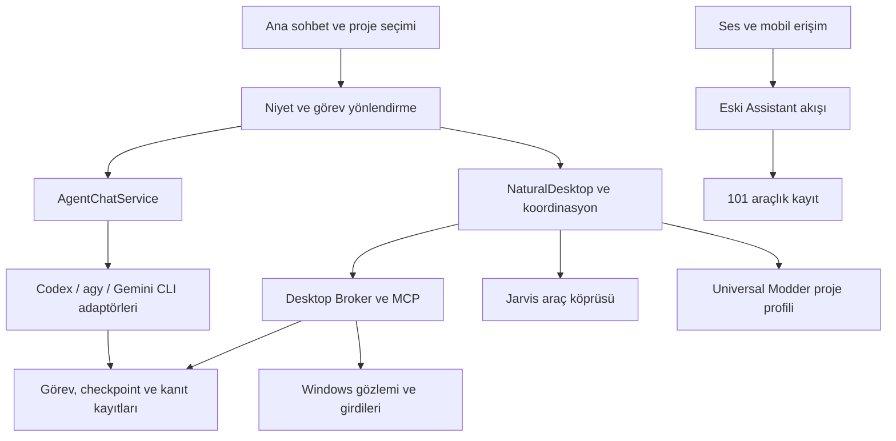

# Quartz — Genel inceleme, özellik envanteri ve geliştirme raporu

Tarih: **28 Ekim 2026**  
İncelenen proje: `C:\Users\LENAVO\Desktop\Jarvis config`  
Kapsam: kaynak, mevcut paket, güvenli regresyonlar, hedefli hata kontrolleri ve mevcut çalışma kanıtları.

## 1. Genel değerlendirme

**Quartz, geniş yetenekleri olan bir geliştirme ve masaüstü asistanı temeline sahip. Ancak farklı kullanıcıların temiz bilgisayarlarında sorunsuz çalışacak, tamamlanmış genel amaçlı bir ürün olarak değerlendirmek için erken.**

Ana sohbetten görev verme, proje bağlamı, Codex/Gemini çalıştırma, çoklu ajan rolleri, masaüstü araçları, checkpoint ve sonuç kanıtı aynı projede mevcut. Bunlar yalnızca tasarım notları değil; kaynakta çalışan mekanizmalar ve bunların önemli bölümünü kapsayan testler var.

Temel sorun özellik sayısının azlığı değil. Yeni CLI tabanlı ajan akışı, masaüstü görev akışı ve eski Jarvis asistanı arasında davranış ve doğrulama farkları bulunuyor. Bir yolda çalışan özellik diğer yolda aynı kalitede sunulmuyor. Özellikle ilk kurulumun başarı ölçütü, hesap seçimi, bazı araç bağlantıları ve hata durumunda veri tutarlılığı düzeltilmeli.

**Önerim:** Yeni büyük özellikler eklemeden önce bu rapordaki P1/P2 kusurlarını kapatmak, ardından gerçek paket üzerinde dar fakat uçtan uca bir kabul paketi oluşturmak. Yeni bir genel framework veya büyük yeniden yazım gerekmiyor.

Kullanıcının bilinçli seçimi olan **tek `full` yetki politikası bu raporda hata sayılmamıştır**. Bu politikayı değiştirmeden Stop, doğru pencere kimliği, yeni gözlem ve kayıt tutarlılığı korunabilir.

Bu incelemede üretim kodu düzeltilmedi, EXE yeniden paketlenmedi, hesaplar değiştirilmedi. Yalnızca rapor ve izole inceleme kanıtları oluşturuldu. ASTER/Warband üzerinde işlem yapılmadı.

## 2. İncelenen sürüm ve kanıt seviyesi

| Ölçüm | Gerçek durum |
|---|---|
| Git HEAD | `fa8383d` — `Unify desktop tasks with the main chat composer` |
| Çalışma ağacı | Commit edilmemiş çok sayıda değişiklik ve yeni modül var; HEAD güncel ürünün tamamını temsil etmiyor |
| `core` modülleri | 49 Python dosyası; toplam 10.780 satır |
| Ana arayüz | `gui.py`: 3.593 satır |
| Test dosyaları | 61 |
| Güvenli regresyon | **508/508 PASS**, 96,225 saniye |
| Eski asistan araç kaydı | 101 araç adı |
| Ana masaüstü MCP şeması | 25 araç adı |
| Paket/kaynak eşleşmesi | Mevcut doğrulayıcının kontrol ettiği modüller, yardımcı araç, CSS ve Q markası için PASS |
| Yayına hazırlık denetimi | **FAIL** — `assets/bin/squad.exe` denetim kuralına takılıyor |
| Çalışan EXE SHA-256 | `3ef70a10f43abe123e6621d85c28ee45ac2cb4579ccf60520428c7a148832026` |

101 ve 25 sayıları toplanıp “126 bağımsız özellik” olarak sunulmamalı. Bazı isimler örtüşüyor ve farklı çalışma yollarına aitler. Eski araç kaydındaki her araç ana Codex/Gemini sohbetinde otomatik olarak sunulmuyor. CLI sağlayıcılarının kendi yerleşik araçları da bu sayılara dahil değil.

Kullanılan kanıt ayrımı:

- **SOURCE:** Uygulama kaynakta mevcut; gerçek kullanım başarısı tek başına kanıtlanmış değil.
- **TEST:** İzole, sahte sağlayıcılı veya statik/JS çalıştırmalı testle doğrulandı.
- **LIVE:** Belirtilen gerçek pencere veya uygulama davranışı gözlemlendi. Kapsamı ayrıca yazıldı.
- **NOT TESTED:** Bu incelemede gerçek kullanım kabulü yapılmadı.

508 testin geçmesi; yeni hesapla giriş, gerçek model yanıtı, masaüstü görevini tamamlama veya temiz Windows kurulumu için LIVE kabul değildir.

## 3. Mevcut mimari

### Güçlü taraflar

1. Görev yürütme ve sonuç doğrulamasını ayırma yönünde gerçek altyapı var. Modelin “bitti” demesi tek başına her yolda başarı kabul edilmiyor.
2. Yazıcı kilitleri, süreç kimliği, geç gelen callback kontrolleri ve yeniden başlatma sonrası toparlanma düşünülmüş.
3. Masaüstü işlemleri yalnızca koordinat göndermekten ibaret değil; pencere kimliği, gözlem ve kapsam kontrolü mevcut.
4. Proje, sohbet, ajan rolü ve görev kayıtları için ayrı bileşenler var.
5. Universal Modder profili, Warband'a özgü korumaları genel masaüstü işlerinden ayırıyor.

### Mimari borç

- `gui.py` hem büyük HTML/JS arayüzü hem çok sayıda Python API girişini taşıyor. Küçük arayüz hatalarının başlangıcı etkileme ihtimali artıyor.
- `agent_chat.py`, `natural_desktop.py` ve `multi_agent_service.py` geniş sorumluluklar taşıyor. Aynı durumların birden fazla temsilini eşzamanlı tutmak zorlaşıyor.
- Eski asistan, yeni CLI ajanı ve masaüstü görevinin sağlayıcı, izin, hata ve kanıt sözleşmeleri tam ortak değil.
- Gemini adaptörü eski Antigravity çalışma biçimini miras alıyor. Bu hızlı entegrasyon sağlamış; ancak timeout ve araç sonucu olaylarının bir kısmı eksik çevriliyor.
- Kaynak, taşınabilir paket, kullanıcı verisi ve kurulum sürümü için daha net bir sürüm/yerleşim sözleşmesi gerekiyor.

**Yapılabilecek en küçük iyileştirme:** Ortak sağlayıcı durum modeli, ortak görev yaşam döngüsü ve ortak araç sonucu kaydı oluşturup mevcut bileşenleri bu sözleşmeye bağlamak. Bütün uygulamayı yeniden yazmak gerekmiyor.

## 4. Özellik envanteri

### 4.1 Sohbet, görev ve proje deneyimi

| Özellik | Durum ve sınır |
|---|---|
| Ana sohbetten normal konuşma | Mevcut; niyet ayrımı ve sohbet yolu var |
| Ana sohbetten bilgisayar görevi | Mevcut; ayrı kontrol ekranı zorunlu olmadan yönlendirme var |
| Türkçe/İngilizce görev niyeti | Mevcut; nezaket kalıpları ve açıklama sorularını ayıran kurallar var; bütün doğal dil ifadeleri için garanti değil |
| “Devam et” ve görev sürdürme | Mevcut; aktif görev/oturum bağlamı ve devam hazırlığı var |
| Görev sırasında ek talimat | İlgili devam/mesaj mekanizmaları mevcut; tüm sağlayıcılar için canlı kesintisiz yönlendirme ayrıca denenmeli |
| Durdur/iptal | Mevcut; görev ve yetki iptali için birden fazla koruma var |
| Sohbet oluşturma ve seçme | Mevcut |
| Proje ekleme ve seçme | Mevcut |
| Projeye göre sohbet ayrımı | Mevcut |
| Sohbet silme | Mevcut; silinen sohbetlerin yedeğini koruyan yaklaşım var |
| Proje sohbetlerini toplu silme | Mevcut; aktif görev korumaları var |
| Ajan/model/düşünme seçimi | Mevcut; sağlayıcının desteklediği seçenekler farklı |
| Ayrıntılı teknik izleri açma | Mevcut |
| Modern Q kimliği, koyu arayüz | Mevcut; paket/ikon eşleşmesi PASS |
| Sohbet araması, arşivleme | Tam kullanıcı akışı bulunmadı; öneriliyor |
| Sohbet dışa/içe aktarma | Tam kullanıcı akışı bulunmadı; öneriliyor |
| Ana sohbette dosya/görsel sürükleyip bırakma | Genel ve uçtan uca doğrulanmış akış bulunmadı; dosya yolu kullanımıyla karıştırılmamalı |
| Klavye ile erişilebilirlik ve ekran okuyucu kabulü | NOT TESTED |

### 4.2 Modeller ve çoklu ajan

| Özellik | Durum ve sınır |
|---|---|
| Codex CLI ile çalışma | Mevcut; Desktop uygulaması zorunlu değil |
| Gemini CLI ile çalışma | Yeni adaptör mevcut; bazı sözleşme eksikleri aşağıda |
| Eski agy/Antigravity yolu | Uyumluluk için mevcut |
| Tek sağlayıcıyla kullanım | Onboarding ve kullanılabilirlik yapısında destekleniyor |
| Hesap girişi ve API anahtarı | İki yöntem var; seçimin kalıcılığı ve doğruluğu geliştirilmeli |
| Model listesi | Codex/agy tarafında katalog mekanizmaları; Gemini tarafında `auto` odaklı sınırlı sunum |
| Paralel Codex/Gemini görevleri | Servis ve rol ayrımı mevcut; güncel pakette gerçek iki sağlayıcılı kabul ayrı gerekli |
| Operatör/gözlemci ayrımı | Mevcut; fare/klavye tek operatörde tutuluyor |
| Squad mesajlaşması | Mevcut; görev bağlamı ve mesaj araçları var |
| Grup değerlendirmesi | Mevcut; sınırlı tartışma/değerlendirme akışı var |
| Tek yazıcı ve proje kilidi | Mevcut; çakışan dosya değişikliklerini azaltıyor |
| Kalıcı yazıcı günlüğü/toparlanma | Mevcut |
| Geç callback ve eski görev sonucu engeli | Mevcut; test kapsamı var |
| Sağlayıcı hata/kota sınıflandırması | Mevcut; gerçek kota ile bağlantı hatasının bütün arayüzlerde ayrımı tamamlanmış değil |
| Birleştirilmiş maliyet/kota ekranı | Tam ve tutarlı ürün akışı bulunmadı; hesap erişimi olmayan değerler UNKNOWN gösterilmeli |

### 4.3 Masaüstü kontrolü

| Özellik | Durum ve sınır |
|---|---|
| Pencere listeleme/inceleme | Mevcut |
| Ekran görüntüsü ve UIA verisi | Mevcut; görüntünün ajana iletilmesi için ayrı araç yolları var |
| Uygulama açma | Mevcut; yürütülebilir dosya kimliği/kapsam kontrolleri var |
| Pencere değiştirme/odaklama | Mevcut |
| Beklenmedik odak değişiminde toparlanma | Mevcut; eski gözlem geçersizleştirilerek yeniden gözlem alınması hedefleniyor |
| Fare/klavye girdisi | Mevcut; Broker yolu güncel gözleme bağlı |
| Çoklu pencere | Mevcut; pencere kapsamı ve kimlik doğrulamasıyla |
| Çoklu ajanla gözlem/kontrol | Rol ayrımı mevcut; iki operatörün aynı anda giriş yapması amaçlanmıyor |
| Pencere PID/start time/EXE doğrulaması | Mevcut |
| Kısa ömürlü, tek kullanımlık gözlem | Broker yolunda mevcut; yaklaşık 15 saniyelik sınır |
| Yerel MCP kimlik doğrulaması | Mevcut; görev bağlantısı ve token kullanılıyor |
| Kilitli/erişilemeyen masaüstünde güvenli durma | Mevcut; başarı olarak sunulmamalı |
| Jarvis hızlı giriş yolu | Mevcut; Broker ile aynı gözlem sözleşmesini tamamen paylaşmıyor |
| Farklı DPI/çok monitör/kilit açma uzun kabulü | Güncel paket için NOT TESTED |
| Uygulamalar arası gerçek görev tamamlama | Tarihsel örnekler var; bu incelemede yeni uçtan uca LIVE kabul yapılmadı |

### 4.4 Proje geliştirme ve Warband

| Özellik | Durum ve sınır |
|---|---|
| Genel dosya tabanlı projelerde çalışma | Mevcut; yalnız ASTER'e özel değil |
| Proje çalışma dizini ve bağlamı | Mevcut |
| Kaynak öncesi checkpoint | Mevcut; Git ref/ZIP mekanizmaları |
| Kaynak değişim özeti/diff | Mevcut |
| Kaynak doğrulaması | Python AST ağırlıklı; gerçek proje derlemesi yerine geçmiyor |
| Görev sonucu ve kanıt kaydı | Mevcut |
| Universal Modder profili | Mevcut; Warband işlerinin yetkili orkestratörü olarak tasarlanmış |
| Warband kaynak/log/başlatma/kontrol | Ayrı MCP araçları mevcut |
| Korunan save denetimi | Warband profilinde mevcut; bu incelemede kayıt dosyalarına erişilmedi |
| Battle-size lease ve geri yükleme | Mevcut proje koruması; bu incelemede oyun başlatılmadı |
| Warband gerçek oyun test yeteneği | Araç ve tarihsel kanıt var; Quartz'ın güncel paketini ASTER üzerinde yeni LIVE kabul saymıyorum |
| Godot/Unity/web gibi proje profilleri | Genel CLI çalışması mümkün; Warband düzeyinde özel doğrulama profilleri bulunmadı |
| Otomatik test/derleme başarısını görev sonucuna bağlama | Kısmi; her proje türü için açık kabul komutu ve kanıt sözleşmesi gerekiyor |
| Checkpoint geri yükleme önizlemesi | Kullanıcı dostu, dosya bazlı birleşik akış geliştirilmeli |

### 4.5 Bağımsız kurulum ve dağıtım

| Özellik | Durum ve sınır |
|---|---|
| Codex/Gemini CLI bulma | PATH ve özel kurulum dizinleri destekleniyor |
| Eksik CLI kurulumu | Mevcut; kullanıcıya büyük Desktop IDE kurulumu zorunlu değil |
| Taşınabilir Node | İndirme ve SHA-256 doğrulama yolu var |
| npm paketi kurulumu | Sabit sürüm/registry ve script çalıştırmama tedbirleri var |
| Süreç için PATH hazırlama | Mevcut; kalıcı sistem PATH değişikliği zorunlu değil |
| İlk kurulum ekranı | Mevcut |
| Anahtar doğrulama isteği | Mevcut; model listeleme erişimini kontrol ediyor, gerçek görev yetkisi/kotasını tamamen kanıtlamıyor |
| Anahtarı `.env` içinde saklama | Mevcut; hafızaya anahtarın ikinci kopyası yerine bağlantı metaverisi yazılması amaçlanmış |
| Eski kurulumu yeniden kullanma | Mevcut fakat sağlık testi atlanabiliyor |
| PyInstaller EXE | Mevcut; mevcut paket kontrolü PASS |
| Inno Setup | Mevcut; yeni EXE ile güncel Setup paketinin eşdeğerliği bu incelemede doğrulanmadı |
| Dijital imza | İncelenen Quartz EXE ve Squad yardımcı EXE: `NotSigned` |
| Temiz Windows kurulumu | Tam LIVE kabul eksik |
| WebView2 önkoşulu | Installer içinde açık bootstrap akışı bulunmadı |
| Kurulum iptali/yarım kurulum/onarım | Bazı hata kontrolleri var; tam kullanıcı kabul matrisi eksik |
| Paket güncelleme ve geri alma | Kaynak/plugin güncellemesi var; güvenilir imzalı EXE güncelleme sistemi değil |

### 4.6 Klasik kişisel asistan özellikleri

| Alan | Mevcut kapsam | Sınır |
|---|---|---|
| Sistem ve dosya | Komut, dosya/dizin, süreç, pano, ekran görüntüsü | Eski araç yolunda mevcut; bütün ana sohbet görevlerine otomatik açık değil |
| Uygulama/medya | YouTube, Spotify, Steam, VS Code, ses denetimi | Uygulama/website değişikliklerine bağlı; güncel LIVE test yapılmadı |
| Ekran analizi | OCR benzeri metin/nesne/hedef, hata analizi, pencere analizi | Ayrı vision sağlayıcı ayarı gerektirebilen yollar var |
| Hafıza/notlar | Bilgi, not, tercih, unutma ve rapor | Proje hafızası ile bütün ajan oturumlarının ortak kaynak göstermesi tam değil |
| Yerel arama | Dizin indeksleme ve metin araması | Sınırlı metin indeksleyici; tam anlamsal kurumsal arama değil |
| Hava durumu | Anlık ve tahmin araçları | Bu incelemede dış servis kabulü yapılmadı |
| Arka plan ajanları | Monitor, araştırma, dosya düzenleme, zamanlama | Zamanlayıcıda somut tekrar hatası var |
| Plugin/MCP | Listeleme, kurma, etkinleştirme, güncelleme/rollback | Güvenilir paket pazarı veya sandbox değil |
| Ses | Bas-konuş, uyandırma, konuşmayı metne çevirme, TTS | Eski assistant yoluna bağlı; yeni CLI sohbetiyle tam eşdeğer değil |
| Mobil | Yerel HTTP/PWA, token ve isteğe bağlı uzaktan erişim hazırlığı | Eski assistant yolunu kullanıyor; tam Quartz çoklu ajan mobil istemcisi değil |

Yerel aramada dosya/chunk sınırları var; PDF için opsiyonel bağımlılığın her kurulumda bulunduğu garanti değil. Ses özelliği gerçek zamanlı, sürekli bir model ses oturumu olarak tanıtılmamalı.

## 5. Kanıtlanmış kusurlar ve öncelikler

P1: Önce kapatılması gereken işlev/veri tutarlılığı sorunu. P2: Önemli güvenilirlik/entegrasyon açığı. P3: Kalite/ürünleştirme iyileştirmesi. Bu sınıflandırma, kusurun bu incelemede kötüye kullanıldığını veya gerçek kullanıcı verisinin zarar gördüğünü söylemez.

### Q01 — Sistem bilgisi ve uygulama listesi yanlış fonksiyon çağırıyor — P1

- Kaynak: `core/natural_desktop.py:638` ve `:640`.
- Çağrılar: `get_full_status()` / `list_running_apps()`.
- Gerçek controller arayüzü: `get_system_info()` / `list_processes()`.
- Hedefli testte iki işlem de **AttributeError** verdi.
- Sonuç: Ajan sistem durumu/süreçleri incelemek istediğinde ilgili Jarvis köprüsü bozulabilir.
- Öneri: Fonksiyon adlarını gerçek controller sözleşmesiyle eşleştir; aracın dispatcher'dan controller'a kadar testini ekle.

### Q02 — İlk kurulum “hazır” durumu doğrulanmış hesap anlamına gelmiyor — P1

- Kaynak: `core/onboarding.py:37–66`; `core/gemini_runtime.py:33`.
- API anahtarının varlığı veya Gemini OAuth dosyasının varlığı `ready` üretmekte yeterli olabiliyor.
- Hedefli testte doğrulanmamış örnek anahtar ile `ready=True`; hiçbir doğrulama yapılmadı.
- OAuth dosyası varlığı geçerlilik, model erişimi veya yeterli kota kanıtı değildir.
- Öneri: `kurulu`, `yapılandırılmış`, `giriş doğrulanmış`, `model erişilebilir`, `son görev başarılı` durumlarını ayrı tut. Kontrol edilmemiş durumu “doğrulanmadı” göster.

### Q03 — Onboarding kayıt işlemi bütün hata yollarında geri alınmıyor — P1

- Kaynak: `core/onboarding.py:90–110`.
- `.env` önce değişiyor; hafızanın nesne olduğu kontrol edilmeden `setdefault` çalışıyor. Bu hata rollback bloğunun dışında.
- Temp dosyalı test: hafıza kökü `[]` olduğunda işlem `error` bitiyor fakat yeni anahtar `.env` içinde kalıyor.
- Ayrı test: bozuk JSON, özgün bozuk kopya korunmadan boş varsayımdan yeniden yazılıyor.
- Gerçek kullanıcı anahtarlarıyla test yapılmadı; örnek değer ve geçici dosyalar kullanıldı.
- Öneri: Her iki dosyayı mutasyondan önce doğrula; bozuk dosyayı koru; tüm yazma/metadata aşamasını ortak geri alma sınırına al.

### Q04 — Hesap bağlantısı ile kullanılacak backend seçimi tutarlı değil — P2

- Kaynak: `core/onboarding.py:123`; `core/gemini_runtime.py:139`.
- Google hesap girişi açılırken mevcut `GEMINI_API_KEY` alt sürece taşınabiliyor.
- Kullanıcının seçtiği giriş yöntemi/backend kalıcı tercih olarak yazılmıyor.
- Örnek test: API anahtarı hesap girişine iletildi; backend tercihi kaydedilmedi.
- Ayrı test: anahtar yok ve eski agy mevcutsa factory önce eski backend'i seçiyor.
- Bu testler gerçek OAuth başarısızlığı kanıtı değildir; **seçilen yöntemle çalıştırılan yöntemin ayrışabildiğini** gösterir.
- Öneri: Sağlayıcı, runtime ve kimlik doğrulama yöntemini açık profil alanları yap; mevcut hesapları silmeden seçime göre ortamı oluştur.

### Q05 — Bulunan CLI çalışabilirlik denetimi olmadan tekrar kullanılıyor — P2

- Kaynak: `core/cli_installer.py:177–182`.
- Mevcut executable çözülürse kurulum `reused=True` dönebiliyor; sürüm/başlatma kontrolü yok.
- Hedefli testte bozuk wrapper senaryosu için sağlık probe sayısı **0**.
- Sonuç: Node'u eksik veya bozulmuş eski kurulum varmış gibi görünüp otomatik onarımı atlayabilir.
- Öneri: Yeniden kullanımda kısa `--version` kontrolü; başarısızsa açık onarım durumu ve kontrollü yeniden kurulum.

### Q06 — Gemini normal görevinde host timeout sözleşmesi eksik — P2

- Kaynak: `core/gemini_runtime.py:51`; `core/antigravity_runtime.py:404–405`.
- agy komutundaki `--print-timeout` Gemini komutuna çevrilmiyor. Ortak bekleme yolu `process.wait()` kullanıyor.
- Komut eşleme testinde timeout iletilmedi.
- Masaüstü görevindeki genel süre koruması, bütün sıradan dosya/sohbet CLI görevlerinde aynı şekilde uygulanmış değil.
- Bu incelemede sağlayıcıyı bilerek kilitleyen canlı deney yapılmadı.
- Öneri: Sağlayıcı argümanından bağımsız host deadline, iptal ve alt süreç temizleme sözleşmesi.

### Q07 — Gemini araç sonucu olayları eksik normalize ediliyor — P2

- Kaynak: `core/gemini_runtime.py:113`; `core/antigravity_runtime.py:355–370`.
- `tool_use` işleniyor; `tool_result` ortak tamamlanmış araç olayına çevrilmiyor.
- Ortak parser bazı komut/dosya kayıtları için `DONE` ve `tool_info` bekliyor.
- Sonuç: Araç yürütümü ile sonuç kanıtı arasında boşluk oluşabilir. Kaynak snapshot/diff kontrolleri bazı değişiklikleri ayrıca yakalayabilir; bütün dosya kanıtının kaybolduğu iddia edilmiyor.
- Öneri: Başlangıç, sonuç, hata, exit code ve dosya değişimini her runtime için aynı şemaya dönüştür.

### Q08 — Araç argümanları hassas içerikle birlikte kayda girebiliyor — P1

- Kaynak: `core/natural_desktop.py:744`.
- Jarvis eylem kayıtları ham `arguments` taşıyor. Pano/yazılacak metin gibi alanlar hassas içerik barındırabilir.
- Yalnız örnek metinle yapılan testte içerik değiştirilmeden kayda girdi.
- Gerçek parola sızması gözlemlenmedi. Bazı diğer kayıt yollarındaki anahtar adına göre maskeleme, genel `text` içeriğini çözmüyor.
- Öneri: Ortak redaksiyon, içerik kaydetmeme seçeneği, log ömrü ve dışa aktarım öncesi temizleme. Tam yetki seçimi, hassas içeriğin gereksiz kopyalanmasını gerektirmez.

### Q09 — Günlük zamanlayıcı ikinci gün aynı saatte çalışmıyor — P2

- Kaynak: `agents/scheduler_agent.py:144–157`.
- `last_run` yalnız `HH:MM` saklıyor. Sonraki gün aynı saat geldiğinde öncekiyle eşit kalıyor.
- İki farklı günün aynı saatiyle izole test: beklenen **2**, gerçekleşen **1** çağrı.
- Görev listesi RAM'de; uygulama yeniden açıldığında kalıcılık yok. Uyku/kaçırılan dakika davranışı da ürün sözleşmesi değil.
- Öneri: Tarih içeren son çalışma kimliği, kalıcı görev deposu ve açık kaçırılmış görev politikası.

### Q10 — Yayın denetimi ile meşru Squad yardımcı paketleme kuralı çelişiyor — P2

- `scripts/audit_publish.py --history` sonucu **FAIL**.
- Tek bulgu: `assets/bin/squad.exe`, `private-or-runtime-path` kuralı.
- `.gitignore` bu helper için özel istisna içerirken denetim bütün ilgili EXE yollarını yasaklıyor.
- CI aynı denetimi testlerden önce çalıştırıyor; bu ağaçla aynı hata CI'ı durdurur.
- Denetim mevcut 255 dosya ve HEAD geçmişindeki 286 blob için çalıştı; secret eşleşmesi raporlanmadı. Bu, bütün disk veya bütün Git ref'leri için güvenlik sertifikası değildir.
- Öneri: Lisans/provenans/hash kontrollü dar allowlist veya build sırasında doğrulanmış helper temini. Denetimi bütünüyle kapatma.

## 6. Kaynakta görülen ürün ve güvenilirlik eksikleri

### Q11 — Masaüstü girdisinin iki farklı sözleşmesi — P2

Broker yolu taze gözlemle eylem bağını doğruluyor. Jarvis girdi yolu da foreground, pencere/session ve kapsam kontrolleri içeriyor; fakat aynı taze screenshot/snapshot sözleşmesini kullanmıyor (`core/natural_desktop.py:546`).

Bu incelemede iki ajanın aynı anda kontrol aldığı bir yarış gösterilmedi; GUI'de ikinci operatörü engelleyen kontroller var. Bulgu, **güvenliğin iki yolda farklı uygulanmasıdır**. Ortak girdi ve sonuç doğrulama arayüzü öneriliyor. Her tıklamada yeniden izin istemek önerilmiyor.

### Q12 — Mobil ve ses yeni ajan sohbetiyle eşdeğer değil — P2/P3

Mobil gateway ve ses komutları eski `assistant.chat` yoluna gidiyor. Yeni Codex/Gemini kurulumu, eski NVIDIA/Groq/GitHub sağlayıcılarını otomatik olarak yapılandırmıyor. Dolayısıyla “CLI sohbeti hazır” bilgisi, mobil/ses akışının da hazır olduğu anlamına gelmiyor.

Mobil erişimde localhost, cihaz token'ı, sabit süreli karşılaştırma, istek sınırı ve gövde sınırı gibi önlemler var. Ancak kullanıcı arayüzünden token yenileme/iptal, oturum listesi ve açık saklama süresi tamamlanmalı. Varsayılanın herkese açık internete açıldığı iddia edilmiyor.

### Q13 — Kurulum ve kaldırma tam ürün yaşam döngüsünü kapsamıyor — P2

Kaynak: `installer/Quartz.iss:18`, `:35`, `:60–90`; `config.py:69` ve veri yolları.

- Açık WebView2 önkoşulu kurma/onarım adımı bulunmadı.
- Sürüm `1.0.0` sabit; EXE/build/Setup kimliğinin kullanıcıya gösterilmesi geliştirilmeli.
- Kullanıcı verilerinin uygulama dizininde bulunması, yöneticiyle Program Files kurulumu ve yazma izinleri için ayrı test gerektiriyor. `{autopf}` ve düşük yetkili kurulum nedeniyle varsayılanın her zaman yazılamayan Program Files olduğu varsayılmamalı.
- “Sohbet geçmişi, hafıza ve API ayarları silinsin mi?” seçeneği yeni `quartz_conversations.json`, `quartz_projects.json`, `mobile_access.json`, `.quartz` ve silinen sohbet yedeklerini tam kapsamıyor.
- AppData CLI kurulumu ve sağlayıcı kimlik bilgilerinin kaldırmada korunma/silinme politikası açık değil. Kullanıcının Quartz dışındaki CLI girişleri körlemesine silinmemeli.
- İncelenen EXE'ler imzasız. Bu zararlı olduklarını göstermez; dağıtımda yayıncı doğrulaması ve güvenilir güncelleme açısından eksiktir.

### Q14 — Plugin/kaynak güncellemesi EXE güncelleyicisi değil — P2

Kaynak: `upgrade_manager.py:739`, `:798`, `:839`.

`self_upgrade` kaynak Git deposunu günceller; kurulu frozen EXE'yi güvenilir bir yeni paketle değiştirmez. `sys.executable -m pip` yaklaşımı frozen durumda normal Python yerine Quartz EXE'sini işaret edebilir. Mevcut plugin taraması basit metin örüntüleri kullanır; sandbox veya güvenilirlik kanıtı değildir.

Pluginler için manifest/hash/lisans ve ayrı bağımlılık kurulumu; ürün için sürümlü, doğrulanan paket güncelleme ve geri alma akışı gerekiyor. Mevcut rollback yedeği yararlı olsa da hedefi silip sonra taşıyan adımlar tam atomik geri yükleme sayılmamalı.

### Q15 — Dokümantasyon ile gerçek davranış ayrışmış — P3

README'de elle CLI/Squad kurulumu ve eski izin varsayımları bulunuyor. Yeni otomatik kurulum, tek Full politikası, backend farkları, mobil/ses sınırları ve doğru paket sürümüyle eşleştirilmeli. Eski raporlardaki kusurlar, güncel kaynakta kontrol edilmeden tekrar açık hata sayılmamalı.

### Q16 — Kaynak doğrulayıcı proje testiyle karıştırılabilir — P2

`source_verification.py` ağırlıklı olarak değişen Python dosyalarının AST kontrolünü yapıyor; dosya/boyut sınırları var. JavaScript, oyun resource'u, C#, asset veya gerçek proje testlerini otomatik olarak doğrulamıyor.

Görev sonucu “kaynak kontrolü geçti” diyebilir; bu tek başına “istenen yazılım davranışı çalıştı” anlamına gelmemeli. Proje bazlı build/test/GUI kabul komutlarının sonuç kanıtına bağlanması gerekiyor.

## 7. Gerçek test sonuçları

| Kontrol | Sonuç | Kapsam |
|---|---|---|
| `scripts/run_safe_tests.py` | **PASS — 508 test** | Mock sağlayıcılar, izole test verileri; gerçek model görevi değil |
| GUI JavaScript kontrolü | PASS | JavaScript sözdizimi kontrolü; görsel kabul değil |
| Paket doğrulayıcı | PASS | Kontrol edilen kaynak/binary yardımcı/CSS/ikon eşleşmeleri |
| Yayın denetimi | **FAIL** | Squad EXE kural çelişkisi |
| Sistem bilgisi araç bağlantısı | **FAILED** | İki eksik fonksiyon çağrısı |
| Hazır durumunun gerçek auth anlamı | **FAILED** | Anahtar varlığı doğrulamasız ready üretiyor |
| Hatalı hafızada onboarding rollback | **FAILED** | İşlem hata verdiği halde yeni anahtar kalıyor |
| Bozuk JSON'u koruma | **FAILED** | Özgün bozuk dosya korunmadan yazılıyor |
| Var olan CLI sağlık probe'u | **FAILED** | Yeniden kullanımda probe 0 |
| Hesap/backend tercihi | **FAILED — sözleşme testi** | Seçim saklanmıyor; mevcut API ortamı aktarılıyor |
| Gemini timeout eşlemesi | Eksik | Argüman düşüyor; canlı asılı süreç üretilmedi |
| Ham araç argümanı maskeleme | **FAILED** | Örnek metin ham olarak kayıtta |
| Günlük zamanlayıcı | **FAILED** | İki günlük örnekte yalnız bir çağrı |
| Gerçek Quartz bağlantı görünümü | **LIVE — dar kapsam** | UIA'da ÇEVRİMİÇİ; son CONNECTING düzeltmesi sonrası health gözlemleri var |
| Yeni gerçek Codex/Gemini görev kabulü | **NOT TESTED** | Bu incelemede ücretli/hesaplı model görevi başlatılmadı |
| Güncel paketle iki ajanlı masaüstü tam görevi | **NOT TESTED** | Kaynak ve tarihsel testler yeni uçtan uca kabul yerine kullanılmadı |
| Temiz Windows VM'de kurulum | **NOT TESTED** | Yeni kullanıcı makinesi kabulü yapılmadı |

Hedefli hata testleri gerçek anahtar, gerçek pano içeriği veya gerçek kullanıcı hafızası üzerinde çalışmadı. Sahte controller/provider ve geçici dosyalar kullanıldı. Üretim test paketinin 508 PASS olması ile bu yeni hedefli kusurların bulunması çelişmiyor: eksik sözleşmeler mevcut regresyonlar tarafından kapsanmıyordu.

### CONNECTING durumu

Önceki düzeltmede arayüzde tanımsız `desktopTaskState` erişimi giderilmiş, gerçek JS çalıştırma testi eklenmişti. Mevcut paketin bu kaynakla eşleşmesi doğrulandı. UIA ve health kanıtı bağlantı göstergesinin toparlandığını destekliyor. Bu, bütün sağlayıcıların hesap/model/kota durumunun çalıştığını kanıtlamaz.

### Performans durumu

Anlık ana süreç örneği: PID 19148, yaklaşık **109,7 MiB RSS**, 16 thread. Bu değer WebView2 ve CLI alt süreçlerini kapsamıyor. Boşta uzun süre ölçümü, 4 GB RAM makine kabulü veya önce/sonra hız kazanımı değildir.

Lazy yükleme, düşük donanım modu, durum sorgusu cache'i ve gizli pencerede polling azaltma kaynakta mevcut. Gerçek kazanç için toplam süreç ağacı, CPU, bellek, ilk açılış süresi ve görev gecikmesi eşleştirilerek ölçülmeli. Bu rapor sayısal bir performans kazanımı iddia etmiyor.

## 8. Eklenmesi veya tamamlanması gereken özellikler

### A. Önce güvenilirlik — zorunlu teknik kapanış

1. Q01–Q10 için dar düzeltmeler ve hatayı önce gösteren regresyonlar.
2. Sağlayıcı durumunun ortak modeli: kurulum, giriş yöntemi, doğrulama tarihi, model erişimi, kota ve son hata.
3. Backend seçiminin kalıcı ve görünür olması; Codex/Gemini/agy tercihlerinin sessizce değişmemesi.
4. Bütün runtime'larda host timeout, Stop, alt süreç temizleme ve aynı sonuç olayları.
5. Hassas içerik kaydetmeme/maskeleme; tanı paketi dışa aktarımında redaksiyon.
6. Onboarding dosya bütünlüğü ve bozuk kullanıcı verisinde güvenli onarım.
7. Paket sürümü, kaynak commit'i, build hash'i ve kurulum sürümünü tek ekranda gösterme.
8. Publication audit ve gerçek dağıtım içeriğini uzlaştırma.

### B. Kullanıcının günlük işini güçlendiren özellikler

| Özellik | Neden gerekli | Öncelik |
|---|---|---|
| Birleşik bağlantı/teşhis ekranı | CONNECTING, hesap, kota, runtime ve Squad sorununu ayırır | Yüksek |
| Görev bazlı kabul kriterleri | “Model bitti dedi” yerine beklenen dosya/test/ekran sonucu aranır | Yüksek |
| Birleşik görev zaman çizelgesi | Kim ne yaptı, hangi araç sonucu geldi, ne doğrulandı anlaşılır | Yüksek |
| Diff ve checkpoint geri yükleme önizlemesi | Değişiklikleri görerek güvenli geri dönüş sağlar | Yüksek |
| Genel proje build/test profili | Warband dışındaki projelerde de doğrulanabilir sonuç sağlar | Yüksek |
| Sohbet araması/arşiv/export/import | Uzun geliştirme geçmişini yönetir | Orta |
| Dosya/görsel ekleri | Ekran ve proje malzemesini ana sohbete doğal biçimde taşır | Orta |
| Kaynak gösteren proje hafızası | Eski karar, dosya ve test kanıtı karışıklığını azaltır | Orta |
| Görev kuyruğu ve yeniden deneme görünümü | Aktif görev, bekleyen iş ve iptal edilen işi açık ayırır | Orta |
| Sağlayıcıya göre kullanım görünümü | Erişilebilen kota/maliyet bilgisini gösterir; bilinmeyeni uydurmaz | Orta |
| Kalıcı zamanlayıcı | Günlük görev, kaçırılan çalışma ve yeniden başlatma davranışını tanımlar | Orta |
| Klavye/ekran okuyucu ve ölçekleme | Farklı ekranlarda kullanılabilirliği güçlendirir | Orta |

### C. Dağıtıma hazır ürün için gerekenler

- Temiz Windows 10/11, farklı kullanıcı adı/dizin ve yönetici olmayan kullanıcı kabulü.
- WebView2 önkoşul kontrolü ve anlaşılır kurma/onarım yolu.
- Uygulama binary'si ile kullanıcı verisini ayıran AppData yerleşimi ve sürümlü migration.
- Windows Credential Manager/DPAPI gibi uygun yerel gizli bilgi saklama seçeneği; anahtarları log ve sohbetten ayrı tutma.
- Kurulumda disk/internet/proxy/TLS hataları, iptal ve yeniden deneme deneyimi.
- CLI sürümü sabitleme, onarma, geri alma ve desteklenen sürüm bilgisini gösterme.
- İmzalı sürümlü EXE/Setup; indirilen güncelleme bütünlüğü ve geri alma.
- Kaldırmada uygulama verisi ile harici CLI hesabını ayıran açık seçenekler.
- Kullanıcının görebileceği gizlilik, veri saklama ve tanı dışa aktarım politikası.

### D. Çekirdek sağlamlaştıktan sonra

Mobil ve sesin ana ajan servisine bağlanması, güvenilir plugin kataloğu, proje türüne özel daha zengin test profilleri ve uzun görev planlaması değerlendirilebilir. Bunlar mevcut bağlantı/kurulum/araç kusurlarını çözmenin önüne geçmemeli.

Bu rapor için Living Encounter, yeni Warband içeriği veya Gate C–G geliştirmesi önerilmiyor. Quartz'ın proje araçları güçlendirilebilir; ASTER kabul süreci ayrı kalmalıdır.

## 9. Önerilen uygulama sırası ve kabul kapıları

### Dalga 1 — Mevcut özellikleri doğru bağla

Q01, Q02, Q03, Q04, Q05, Q08, Q09 ve Q10. Ardından Q06/Q07 runtime sözleşmesi.

**Kabul:** Hedefli kusur örnekleri artık geçmeli; 508 test ve eklenecek regresyonlar PASS; gerçek `.env`/sohbet/hafıza korunmalı; paket doğrulaması PASS. Hesap bağlantısı yalnızca dosya varlığıyla yeşil olmamalı.

### Dalga 2 — Gerçek paket üzerinden uçtan uca kabul

1. Boş kullanıcı profili → yalnız Codex ile giriş → ana sohbet → küçük proje görevi → gerçek dosya/test kanıtı.
2. Aynı akış yalnız Gemini ile; Desktop IDE olmadan.
3. İki sağlayıcı mevcutken gerçek paralel operatör/gözlemci görevi ve Squad mesajı.
4. Ana sohbetten gerçek test uygulaması: gözlem → teşhis → normal UI işlemi → yeniden gözlem → sonuç doğrulaması.
5. Odak değişimi, Stop, kapatılmış pencere, stale screenshot, izin kapsamı ve yeniden görev.
6. İkinci görev ve yeni sohbet/proje; eski state/callback kalmaması.
7. Başlatma/bağlantı hatasının anlaşılır Türkçe açıklanması; sonsuz CONNECTING olmaması.

**Kabul:** Yalnız mock veya CLI çıktısı değil; paketli ana sohbetten ekran/araç/sonuç kanıtı. ASTER yerine disposable test uygulaması ve geçici proje kullanılmalı.

### Dalga 3 — Yeni kullanıcı ve dağıtım

Temiz VM, WebView2, CLI kurulum/onarım, veri migration, uninstall ve sürüm güncelleme/rollback.

**Kabul:** Geliştirici makinesindeki önceden kurulu araçlardan yararlanmadan ilk görev tamamlanmalı. İnternet gerektiği kullanıcıya açık olmalı; “bağımsız” ifadesi çevrimdışı model veya sıfır ağ gereksinimi anlamına gelmemeli.

### Dalga 4 — Kullanım kalitesi

Sohbet araması, dosya ekleri, görev zaman çizelgesi, geri yükleme önizlemesi, erişilebilirlik ve ölçülmüş düşük donanım performansı.

Süre tahmini veya tamamlanma yüzdesi uydurulmadı. Öncelik, daha fazla buton yerine daha az belirsiz durum ve daha güvenilir görev sonucudur.

## 10. Bu incelemede korunma ve sınırlar

- Üretim kaynaklarına düzeltme uygulanmadı; yeni rapor ve izole `labs/general-review-20261028` kanıtları eklendi.
- Kullanıcı API anahtarları rapora alınmadı; gerçek anahtar doğrulama isteği gönderilmedi.
- Hata örnekleri geçici dosyalar ve sahte servislerle çalıştırıldı.
- Açık kullanıcı uygulaması kapatılmadı; Quartz yeniden başlatılmadı.
- Registry, sürücü, Overlay, güvenlik ve sistem yetkileri değiştirilmedi.
- Warband/ASTER kaynaklarına, oyun kayıtlarına ve gameplay'e dokunulmadı.
- İnceleme sonunda kaynak/paket tarafındaki dokuz kullanıcı veri dosyasının hash'leri, CONNECTING düzeltmesinden önceki koruma manifestiyle yeniden karşılaştırıldı: **9/9 eşit, değişen dosya 0**. Anahtar içerikleri okunup raporlanmadı; yalnız dosya hash'leri karşılaştırıldı.
- Güvenlik bulguları tam bir pentest değildir. Gerçek istismar veya parola sızması iddiası yapılmıyor.
- İnceleme sırasında mevcut her özelliğin dış servis/gerçek model kabulü yapılmadı; bu alanlar özellikle sınırlandı.

## 11. Kanıt dosyaları

Yeni inceleme kanıtları:

- `labs/general-review-20261028/inventory.json` — modül/sınıf/fonksiyon envanteri.
- `labs/general-review-20261028/summary.json` — araç adları, sayılar ve sınırlı süreç örneği.
- `labs/general-review-20261028/regression.log` — 508 test sonucu.
- `labs/general-review-20261028/package-verification.json` — mevcut paket/kaynak kontrolleri.
- `labs/general-review-20261028/publish-audit.json` — yayın denetimi bulgusu.
- `labs/general-review-20261028/source-references.json` — önemli satır bağlantıları.
- `labs/general-review-20261028/probes.py` — izole hedefli hata örnekleri.
- `labs/general-review-20261028/targeted-probes.json` — hedefli kontrol sonuçları.
- `labs/general-review-20261028/preservation.json` — bu incelemenin sonundaki dokuz kullanıcı veri dosyası karşılaştırması.

Önceki CONNECTING düzeltmesinin gerçek gözlem ve dağıtım kanıtı:

- `C:\Users\LENAVO\.codex\backups\quartz-connecting-20261028\live-uia.txt`
- `C:\Users\LENAVO\.codex\backups\quartz-connecting-20261028\live-health.txt`
- `C:\Users\LENAVO\.codex\backups\quartz-connecting-20261028\deployment-receipt.json`
- Aynı klasörde `data-before.json` ve `data-after.json`: önceki devreye almanın dokuz kullanıcı veri dosyası kontrolü.

Bu raporun hazırlanmasında kullanılan araç envanteri kaynak anını temsil eder. Sonradan değişen kod ve paket için yeni doğrulama gerekir.

## Ek A — Eski asistan araçlarının tam ad listesi

Bu liste kayıtlı araçları gösterir. Bir aracın burada olması, her sağlayıcıya ana sohbetten açık olduğu veya güncel dış uygulamayla canlı kabul edildiği anlamına gelmez.

| Grup | Araçlar |
|---|---|
| Keşif ve eski masaüstü | `discover_tools`, `desktop_windows`, `desktop_inspect`, `desktop_action` |
| Sistem/dosya | `run_command`, `run_command_async`, `read_file`, `write_file`, `append_file`, `delete_file`, `list_directory`, `create_directory`, `copy_item`, `move_item`, `get_system_info`, `list_processes`, `kill_process`, `mouse_click`, `mouse_move`, `type_text`, `press_keys`, `take_screenshot`, `get_clipboard`, `set_clipboard`, `open_url`, `open_file_explorer` |
| Uygulama/medya/işletim sistemi | `youtube_play`, `youtube_search`, `spotify_play`, `spotify_control`, `steam_open_library`, `steam_install_game`, `vscode_open_file`, `vscode_open_folder`, `vscode_create_and_run`, `set_volume`, `get_volume`, `mute_volume`, `browser_open_url`, `google_search`, `system_shutdown`, `system_restart`, `system_sleep`, `quartz_mode`, `lock_screen`, `empty_recycle_bin`, `smart_open`, `type_and_enter`, `hotkey`, `clipboard_copy`, `clipboard_paste` |
| Görüntü | `analyze_screen`, `what_is_on_screen`, `read_screen_text`, `find_on_screen`, `locate_screen_target`, `screen_click_target`, `analyze_window`, `activate_window`, `wait_for_screen_change`, `help_with_screen`, `analyze_error` |
| Hafıza | `remember_fact`, `recall_fact`, `add_note`, `get_notes`, `delete_note`, `set_preference`, `get_memory_report`, `forget_fact` |
| Yerel arama | `index_local_folder`, `search_local_files` |
| Hava | `get_weather`, `weather_forecast` |
| Plugin/güncelleme | `install_plugin`, `update_plugin`, `update_all_plugins`, `remove_plugin`, `list_plugins`, `rollback_plugin`, `self_upgrade` |
| Arka plan ajanları | `start_monitor`, `stop_monitor`, `monitor_status`, `monitor_alerts`, `start_research`, `get_research`, `schedule_task`, `list_scheduled`, `remove_scheduled`, `start_file_agent`, `stop_file_agent`, `organize_files`, `file_stats`, `all_agents`, `stop_all_agents` |
| Eski MCP | `list_mcp_skills`, `install_mcp_skill`, `activate_mcp_skill`, `show_mcp_tools`, `use_mcp_tool` |

## Ek B — Ana masaüstü MCP araçlarının tam listesi

| Grup | Araçlar |
|---|---|
| Görev ve masaüstü | `task_context`, `desktop_request_access`, `task_wait`, `task_message`, `task_read_log`, `desktop_verify`, `desktop_windows`, `desktop_switch`, `desktop_launch`, `desktop_focus`, `desktop_observe`, `desktop_act` |
| Jarvis köprüsü | `jarvis_open_app`, `jarvis_media_web`, `jarvis_system_info`, `jarvis_input` |
| Universal Modder/Warband | `warband_status`, `warband_request_access`, `warband_source`, `warband_run`, `warband_log`, `warband_verify`, `warband_observe`, `warband_start_game`, `warband_act` |

## Nihai hüküm

**Geliştirici kullanımı:** Güçlü ve kullanılabilir bir temel; bazı yolların kısmi olduğunu bilerek ve sonuç kanıtlarını denetleyerek kullanılabilir.

**Yeni kullanıcıya sorunsuz dağıtım:** Henüz yeterince doğrulanmış değil. Önce onboarding/veri tutarlılığı, sağlayıcı sözleşmeleri ve gerçek paket kabulü kapatılmalı.

**En doğru sonraki adım:** Yeni kapsam eklemeden Q01–Q10 düzeltmelerini yapmak; ardından yalnız Codex, yalnız Gemini ve iki ajanlı masaüstü senaryolarını gerçek paket üzerinden bitirmek.
