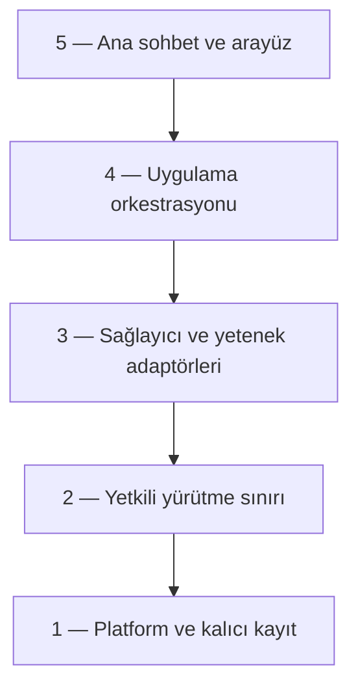

# Quartz sistem piramidi — çalışma sözleşmesi

Tarih: 2026-11-01. İncelenen kaynak baseline: e2ce872. Bu belge mevcut
uygulamanın zaten bu mimaride olduğunu iddia etmez; kontrollü geçiş hedefidir.
Çalışan Notion'sız paket ve kullanıcı verileri bu mimari incelemede değişmedi.

## Ürün odağı

Tek sohbetten iki ajanla konuşma/geliştirme/uygulama kontrolü. Codex ve
Antigravity sağlayıcıdır; görev, izin, veri ve başarı tanımının sahibi Quartz'tır.
Notion dış ortak hafızadır, uygulamanın üçüncü ajanı veya açılış bağımlılığı
değildir. ASTER adaptörü dondurulmuş, isteğe bağlı tarihsel alandır.

## Beş katman

Bağımlılık yukarı yönlenmez. Sonuçlar yukarıya olay/durum verisi olarak döner;
alt katman GUI import etmez. Doğrudan çağrıların güvenlik denetimini atlaması
yasaktır. İzin, Stop, sahiplik ve kanıt bütün katmanlarda korunacak sözleşmelerdir;
yalnız tabanda duran ve üst katmanın isterse atlayacağı kontroller değildir.

| Katman | Sorumluluk | Mevcut kaynak karşılığı | Burada olmaması gereken |
|---|---|---|---|
| 5. Etkileşim | Sohbet, render, model seçimi, izin sunumu, Stop, dosya/pencere seçicisi | gui.py, ui/*, assets/workspace.css | Sağlayıcı başlatma/yeniden deneme, görev sahipliği ve başarı kararı |
| 4. Uygulama | Niyet, görev bağlamı, rol dağıtımı, devam, iptal, sonuç birleştirme | agent_chat.py, multi_agent_service.py, natural_desktop.py, chat_coordination.py, message_intent.py, diagnostics_intent.py | Doğrudan fare/klavye veya kontrolsüz Popen |
| 3. Adaptör | CLI ve Squad protokolleri; masaüstü/REA/onarım gibi belirli yetenekler | codex_runtime.py, antigravity_runtime.py, gemini_runtime.py, squad_adapter.py, artifact_diagnostics.py, rea_adapter.py, package_repair.py, desktop_agents.py | Ürün görevinin hedefini kabul etme veya kapsamı genişletme |
| 2. Yürütme sınırı | Scope, pencere kimliği, tek operatör/yazıcı, checkpoint, işlem ve dosya kontrolü | desktop_broker.py, desktop_control.py, desktop_native.py, desktop_launch.py, desktop_mcp.py, elevation.py, writer_journal.py, workspace_checkpoint.py, source_verification.py | Model metninden izin üretme, sahipsiz süreç kapatma, doğrulamasız yan etki |
| 1. Platform/kayıt | Atomik kayıt, dosya kimliği, süreç ağacı, auth taşıma, kurulum kaynakları | atomic_json.py, path_identity.py, local_ipc.py, process_tree.py, conversation_store.py, run_evidence_store.py, project_registry.py, cli_installer.py, install_security.py, windows_prerequisites.py | İş hedefi seçme, GUI'den haberdar olma, sessiz hesap/model değiştirme |

Bu tablo modüllerin hedef sorumluluğudur; dosyalar bugün birden fazla katman
taşıyabilir. İlk adım klasörleri taşımak veya mevcut her sınıfın üstüne yeni
bir manager eklemek değildir. Mevcut broker, journal ve adapter korunur.

## Gözlenen yapısal açıklar

Kaynak/AST bulgularıdır; canlı hata veya tam güvenlik denetimi değildir.

| Bulgu | Kanıt | Etki / kapanış ölçütü |
|---|---|---|
| UI ile iş yaşam döngüsü iç içe | gui.py 3920 satır; AST'de 14 core modül import'u; diagnostics_select_application doğrudan ArtifactDiagnosticsService kuruyor | UI yalnız güvenilir kullanıcı seçimi üretir; yaşam döngüsü sahibi uygulama servisinde netleşir |
| Birden çok görev modeli var | TaskEngine, ContinuityEngine, AgentChatService._active_turn, runtime._runs, NaturalDesktopTask.job | Görev ile run/CLI oturumu ayrımı ve durum eşleştirmesi ortak olmalı; hepsi tek dict'e zorla taşınmamalı |
| Eski ve yeni sağlayıcı yolları farklı | assistant.py ProviderManager/TaskEngine kullanır; MultiAgentService CLI runtimelarını yönetir; main.py eski yolu lazy açar | Hangi çağrının hangi motora gittiği route haritasıyla görünür olmalı; eski yolu körlemesine silme |
| Kapanış birden fazla yerde | gui.Api.cleanup_before_exit, IPCServer.stop, runtime.shutdown, quartz_entry.py os._exit(0) | İzin kesme, child stop, receipt flush ve kapanış sonucunun sırası doğrulanmalı; _exit hemen silinmez |
| UI-servis sınırı henüz kısmi | ui/styles.py ve document.py ayrılmış; gövde/JS/Api gui.py içinde | gui._HTML uyumluluğu ve JS kontrolü korunarak küçük dilimler |
| Tamamlanma ile doğrulama ayrı ama her yol için ortak değil | task_outcome.execution_outcome bunu ayırıyor; farklı runtime ve UI state'leri var | Mevcut sözlüğü kullan; model tamamlandı diye kullanıcı hedefi başarılı gösterilmesin |
| Durum/cache/polling sahipliği parçalı | AsyncSnapshot, GUI polling, service ve provider probe cache'leri | Her bilgi için bir asıl kaynak; UI polling yeni model işi/login başlatmasın |
| Dağıtım ve kaynak referansları ayrışabiliyor | Ana checkout ee41b40, son geliştirme/dağıtım ayrı worktree'de e2ce872 | Build kaynak SHA, paket hash ve veri/rollback manifesti tek teslim kaydında tutulmalı |
| Aktif sahiplik belgesi eski Notion işine yönlendiriyor | docs/PARALLEL_OWNERSHIP.md başlığı | Yeni üç ajan manifesti aktif; eski kapsam tarihsel |
| Uçtan uca görsel kabul açığı sürüyor | Son dağıtım UIA doğrulandı, screenshot iki channel timeout | UIA ve piksel kabulü ayrı; yakalama engeli başarıya çevrilmez |

Statik envanter 66 core modülü içeriyor; 6 Notion prototip modülü arşiv
olarak işaretli. Tam import/sınıf listesi SOURCE_INVENTORY.json içindedir.
Statik AST, koşullu/lazy import'u da sayar; gerçek runtime trace değildir.

## Ortak veri ve otorite sözleşmesi

Yeni bir TaskEngine yazılmayacak. Önce mevcut kayıtlar arasında eşleme yapılacak:

- task_id: kullanıcı hedefi; run_id: belirli sağlayıcı çalıştırması;
  session_id: CLI sohbeti. Birbirlerinin yerine kullanılmaz.
- conversation_id/project_id bağlamdır; scope_ref/izin isteği/generation
  yetkili yerel kayda bağlanır. Uzak model veya Squad mesajı grant oluşturamaz.
- Provider'a ait thread/session kimlikleri değiştirilmez; gerekirse Quartz
  correlation kaydıyla bağlanır. Eski sohbetler migrate edilmeden okunur.
- Execution, evidence, acceptance ve cleanup ayrı alanlar olarak kalır.
  Ortak sonuç için mevcut task_outcome ve run_evidence_store temel alınır.
- Durum geçişleri queued → running → awaiting_approval → running/verifying
  → completed/failed/cancelled/blocked olarak eşlenir; bu yeni önerilen
  uygulama sözleşmesidir, mevcut bütün modüllerin hâlihazırda desteklediği iddiası değildir.
- İzin cevabı yalnız aynı canlı task + pending request + generation'a uygulanır.
  Çift callback yan etkiyi tekrar üretmez. Stop yerel yetkiyi önce keser.
- Yerel tek operatör ve tek yazıcı farklı kilitlerdir. İnceleme rolüne
  işletim sistemi düzeyinde sağlanmayan salt okunurluk garantisi verilmez.
- UI'nın native picker/onay olayı güvenilir giriş sınırıdır. Bu sınırı
  backend'e keyfî IPC path göndererek izin üretme yoluna dönüştürme.

Tam Yetki tercihi korunur; eski üç yetki modunu yeniden getirme. Bu tercih
UAC, taze gözlem, kapsam ve veri korumalarını kaldırmaz.

## Bütün sistemlerin durumu

| Alan | Karar |
|---|---|
| Sohbet ve intent | Aktif ana giriş; normal konuşma araç başlatmamalı |
| Codex / Antigravity / Gemini CLI seçimi | Aktif; hesap, model, kota ve bağlantı durumları sağlayıcıya ait |
| Squad / roller | Aktif; önce plan/rol, sonra görev kapsamı; iki fiziksel operatör yok |
| Desktop / çoklu pencere / UAC / overlay | Aktif; mevcut broker ve input safety korunur |
| Proje / writer / checkpoint / rollback | Aktif; yazı öncesi doğrulanmış yedek, yazı sonrası diff/kanıt |
| REA / uygulama bilgisi / öz teşhis / repair | Aktif ama görevden çağrılan yetenek; genel ajan hafızası veya izin yerine geçmez |
| Onboarding / CLI install / WebView2 / paket / güncelleme | Platform yaşam döngüsü; gerçek temiz makine kabulü ayrı |
| Sohbet/hafıza/geçmiş/log | Yerel veri ve kanıt katmanı; silme/retention ayrı kullanıcı kararı |
| Plugin/tool registry ve legacy assistant/voice/mobile | Uyumluluk alanı; route/çağrılma kanıtı çıkarılmadan kaldırma veya startup'ta ağırlaştırma yok |
| Notion araç ajanı | Durduruldu, UI'dan kaldırıldı; prototip korunur, tekrar aktif edilmez |
| Notion ortak hafıza | Dış çalışma kaynağı olarak korunur; Quartz'ın açılış şartı değil |
| Warband/ASTER | Rafa kaldırıldı; mimari görevinde çalıştırma/değiştirme yok |

## Geçiş: beş küçük teslim

1. **P0 — sınır ve baseline (bu teslim):** envanter, katmanlar, sahiplik ve
   kabul sözleşmeleri. Üretim davranışı değiştirilmez.
2. **P1 — bir akışın sözleşmesi:** mevcut sohbet → görev → run → kanıt →
   Stop/kapanış yolunda kimlik/durum eşlemeleri ve sahipleri çıkarılır;
   gerçek eksik bağlantıya minimal adaptasyon yapılır. Yeni genel motor yok.
3. **P2 — UI ayrıştırma:** body/JS/bridge küçük dilimlere ayrılır; gui._HTML,
   mevcut pywebview API ve paket asset sözleşmesi korunur. Yeni tasarım yok.
4. **P3 — runtime/kapanış:** process-tree sahipliği, bounded shutdown,
   login/probe maliyeti ve tüm süreç ağacı ölçümü; iptal sonuçları dürüst kalır.
5. **P4 — birleşik paket:** aynı baseline üzerinde kontrat + Windows suite +
   paket + canlı ana sohbet, desktop izin/Stop ve restart/koruma kontrolü.

P1, P2 ve P3 farklı dosyalarda paralel ilerleyebilir; ortak sözleşme önce
sabitlenir. Her değişiklik küçük commit, checkpoint ve geri alma yolu taşır.
P1'de ilk kimlik/yayın sınırı düzeltmesi SOURCE/TESTED düzeyinde tamamlandı
(CODEX_P1.md); birleşik BUILT/LIVE ve diğer geçiş dilimleri açık. Özel yeni engine/registry veya geniş rewrite
ile bu planın üstüne altıncı bir mimari eklenmeyecek.

## Kabul kapıları

- Konuşma: model/araç çağrısı yapmadan verilebilen yanıtlar işi başlatmaz.
- Kod: görev/rol → tek writer claim → checkpoint → gerçek değişiklik → test
  → diff ve kanıt; inceleyen ajan yanlışlıkla ikinci yazıcı olmaz.
- Desktop: taze gözlem → mevcut kapsam izni → tek operatör eylemi → yeniden
  gözlem. Eski onay, duplicate ve yanlış pencere işlemi engellenir.
- Devam/Stop: yeni mesaj doğru göreve gider; Stop sonrası yeni yan etki yok;
  remote cancellation bilinmiyorsa açık bildirilir.
- Yeniden açılış: sahipsiz child veya otomatik canlanan grant yok; bozulmamış
  kayıtlar; cleanup başarısızlığı örtülmez.
- Temiz kurulum: Desktop IDE zorunluluğu yok, eksik provider uygulamayı çökertmez.
- Kanıt: SOURCE/TESTED/BUILT/LIVE ayrı; eski test yeni build'e otomatik taşınmaz.

Gerçek kritik bug kanıtı olmadan var olan davranışı düzeltme bahanesiyle
değiştirme. Hedef daha fazla özellik değil, daha az belirsiz sorumluluktur.
