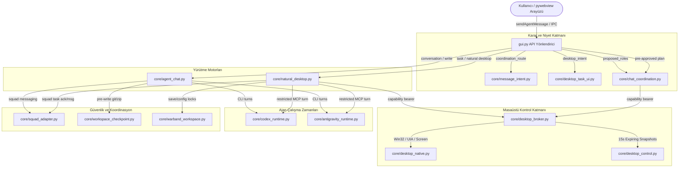
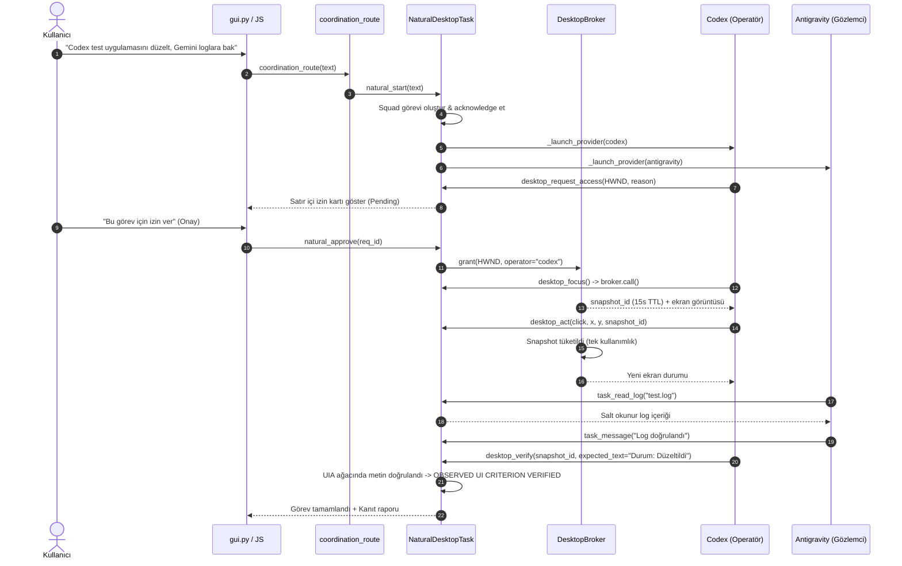

# Quartz Mimari Haritası (Architecture Map)

**İnceleme Tarihi:** 25 Ekim 2026  
**İncelenen Git Commit:** `36a2d9ea8a8abdd744195fa84ff8eec61b3f7444`  
**İnceleyen:** Gemini 3.8 Flash High (Bağımsız Güvenilirlik ve Mimari İncelemesi)  
**Çalışma Alanı:** `C:\Users\LENAVO\Desktop\Jarvis config`  

---

## 1. Genel Mimari Bakış

Quartz; Windows işletim sistemi üzerinde yerel olarak çalışan, pywebview (Edge WebView2) tabanlı bir masaüstü arayüzü ile arka plandaki Python çekirdeğini aynı süreç içinde birleştiren çoklu ajan asistanıdır. Sistem; OpenAI Codex CLI (`codex`) ve Google Antigravity CLI (`agy`) araçlarını tek bir masaüstü ve sohbet bağlamında koordine eder.

---

## 2. Temel Bileşenler ve Görev Sorumlulukları

### 2.1 Arayüz ve Yönlendirme (Frontend & Dispatch)
* **`gui.py` (`QuartzGUI` / `QuartzWindow`):**
  * pywebview penceresini ve gömülü HTML/CSS/JS arayüzünü yükler.
  * Tekil süreç içi IPC (`core.local_ipc`) yetkisiyle tarayıcı API çağrılarını (`pywebview.api.*`) karşılar.
  * Kullanıcının girdiği her mesajı önce `coordination_route` süzgecinden geçirir; mesajın görev mi, sohbet mi, devam komutu mu olduğunu belirler.
  * İzin kartlarını (`data-natural-permission`) periyodik olarak UI akışına enjekte eder (`pollNaturalTask`).

### 2.2 Niyet Ayrıştırma ve Yönlendirme (Intent Classification)
* **`core/message_intent.py` (`message_intent`, `tools_disallowed`):**
  * `conversation`, `task`, `continuation` durumlarını regex kurallarıyla sınıflandırır.
  * `sadece sohbet edelim`, `araç kullanma` gibi ifadelerde aktif görevleri durdurur (`tools_disallowed`).
* **`core/desktop_task_ui.py` (`desktop_intent`, `desktop_view`):**
  * Masaüstü ve uygulama anahtar kelimelerini (`pencere`, `not defteri`, `kontrol et`, `ekran görüntüsü al`) tarar.
  * Arayüzdeki kontrol durumunu (`normal`, `preparing`, `pending`, `active`, `released`) biçimlendirir.
* **`core/chat_coordination.py` (`proposed_roles`):**
  * Çok katılımcılı koordinasyon için operatör ve gözlemci rollerini ayırır.

### 2.3 Sohbet ve İş Birliği Yürütücüsü (Chat & Multi-Agent Engine)
* **`core/agent_chat.py` (`AgentChatService`):**
  * Tekil sohbet (Codex veya Antigravity) ve "Birlikte" modunu (Collaboration) yönetir.
  * Yazma (`write=True`) ve Tam Yetki (`full_access=True`) durumlarında dosya checkpoint'i alır (`core/workspace_checkpoint.py`).
  * Birlikte modunda **Tek Yazıcı Kuralı** uygular: Yalnızca Codex yazar, Antigravity bağımsız salt-okunur inceleme yapar.
  * İki yönlü tartışma turlarını (`_run_mutual_evaluation_round`) ve Squad mesaj senkronizasyonunu yürütür.

### 2.4 Doğal Masaüstü Görev Yürütücüsü (Natural Desktop Task)
* **`core/natural_desktop.py` (`NaturalDesktopTask`):**
  * Kullanıcının ana sohbete yazdığı doğal dildeki masaüstü isteklerini (`Codex uygulamayı incele, Gemini loglara bak`) alır.
  * Operatör ve gözlemci rollerini belirler, izole Squad görev kimliği açar.
  * Yerel `ThreadingHTTPServer` kurarak ajanlara MCP sunucu portu ve oturum token'ı sağlar (`task_context`, `task_wait`, `task_message`, `desktop_request_access`, `task_read_log`, `desktop_verify`).
  * Uygulama penceresi ve log dosyası erişimi gerektiğinde satır içi izin istemi (`self.pending`) oluşturur.
  * Yalnızca onaylanmış operatörün fare/klavye/gözlem çağrılarını `DesktopBroker`'a iletir.

### 2.5 Masaüstü Yetki Hakemi (Desktop Broker & Native Control)
* **`core/desktop_broker.py` (`DesktopBroker`):**
  * Sistemdeki tekil masaüstü yetki otoritesidir (`acquire_lease`).
  * 15 saniye ömürlü tek kullanımlık snapshot mimarisi (`verify_observation`, `desktop_act`) uygular.
  * Kullanıcı pencereyi değiştirdiğinde veya odağı aldığında derhal durur (`foreground changed (user takeover)`).
* **`core/desktop_native.py` (`NativeDesktopBackend`):**
  * Windows UI Automation (pywinauto) ve Win32 API (`user32.dll`) üzerinden pencere hiyerarşisi, koordinat tıklaması ve odak kontrolünü yönetir.
  * `is_foreground` ile hedef pencerenin gerçekte önde olup olmadığını çoklu masaüstü (`exebox` sanal masaüstü vs `Default` masaüstü) farkındalığıyla denetler.

### 2.6 Çalışma Zamanı Sağlayıcıları (Runtimes)
* **`core/codex_runtime.py` (`CodexRuntime`):**
  * `codex exec --experimental-json` sürecini yönetir.
  * Model (`gpt-6-luna`, `gpt-6.1-sol` vb.), düşünme seviyesi (`effort`) ve oturum devamını (`resume_thread_id`) sağlar.
* **`core/antigravity_runtime.py` (`AntigravityRuntime`):**
  * `agy --mode ...` süreçlerini yönetir.
  * MCP sunucu kaydı (`agy mcp add quartz-desktop`) ve hooks yapılandırmasını kurar.

---

## 3. Gerçek Bağlantılar ve Durum Akış Diyagramı

